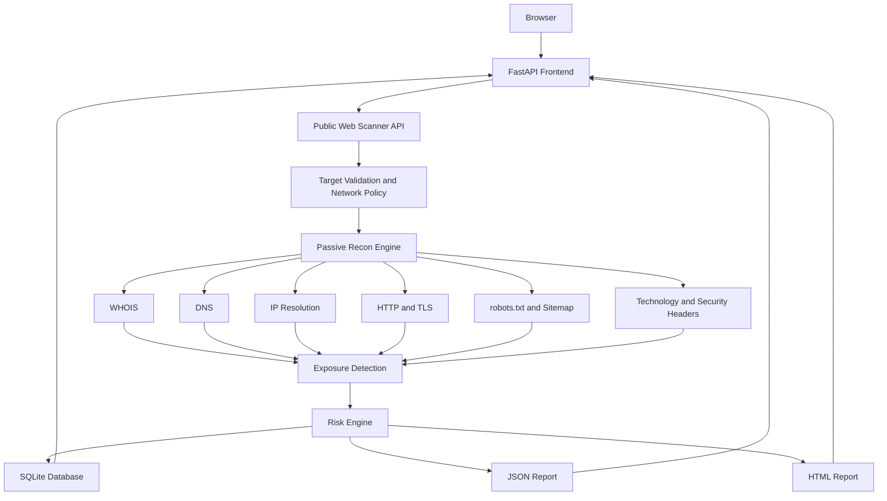

# Web Recon Automation Framework

Web Recon Automation Framework is a passive-only web reconnaissance application for authorized security assessments. It collects publicly available security-relevant information and produces structured JSON and HTML reports.

The current project includes:

- A Python CLI for direct reconnaissance runs.
- A FastAPI application with a browser-based scanner.
- The existing passive reconnaissance engine shared by both entry points.
- Local database persistence for web investigations.
- Real-time persisted scan status and report retrieval.
- Normalized asset inventory and paginated investigation history.
- Evidence-aware scan comparisons and downloadable HTML comparison reports.

Use this project only against systems you own or are explicitly authorized to assess.

## Web Application

The local application flow is:

```text
Browser -> FastAPI frontend -> passive recon engine -> SQLite database -> JSON/HTML reports -> browser results
```

The frontend is served by FastAPI at `/app/`. A user enters a public domain or URL, starts a scan, watches the persisted status update, and reviews the returned evidence categories and generated reports.

The public browser scanner uses these same-origin endpoints:

| Endpoint | Purpose |
| --- | --- |
| `POST /web-api/investigations/` | Queue a target for passive reconnaissance |
| `GET /web-api/investigations/{id}` | Read persisted status, progress, and completed results |
| `GET /web-api/investigations/{id}/report/download` | Retrieve the generated JSON report |
| `GET /web-api/investigations/{id}/report/html` | Retrieve the generated HTML report |
| `GET /web-api/assets?skip=0&limit=50` | List normalized assessed assets with first/last-seen dates and scan counts |
| `GET /web-api/assets/{asset_id}/investigations?skip=0&limit=20` | Read paginated history for one asset |
| `POST /web-api/investigations/compare` | Compare two completed scans of the same normalized target |
| `GET /web-api/investigations/{previous_id}/compare/{current_id}/report` | Generate an HTML comparison report on demand |
| `GET /health/db` | Check local database availability |

The separate `/api` investigation and dashboard routes are protected by the configured backend API key and are intended for internal/API clients. The browser UI does not request or expose that key.

## Architecture



The CLI uses the same passive reconnaissance modules and reporting layer without the browser or FastAPI frontend.

## Features

- Passive WHOIS lookup.
- DNS records: A, AAAA, MX, NS, TXT, and CNAME.
- IPv4, IPv6, and reverse-DNS resolution.
- HTTP response metadata, redirects, cookies, cache headers, and bounded response content.
- Verified TLS certificate inspection, including issuer, subject, validity, signature algorithm, and SAN entries.
- `robots.txt` collection.
- `sitemap.xml` and `sitemap_index.xml` collection.
- Technology detection from explicit passive response headers, HTML generator metadata, recognized cookie names/attributes, and known product asset paths; matches include evidence and confidence.
- Security-header inspection for HSTS, CSP, X-Frame-Options, X-Content-Type-Options, and Referrer-Policy.
- Passive URL-candidate extraction from robots.txt, sitemaps, and HTML references. Discovered candidate paths are not requested automatically.
- Heuristic observations kept separate from exact-request HTTP evidence; this engine does not confirm misconfigurations or vulnerabilities.
- Deterministic observed risk-point scoring with evidence-completeness interpretation.
- Rich CLI output with scan status, candidate URLs, heuristic observations, and execution summary.
- Structured JSON reports and generated HTML reports.
- File logging through `logs/recon.log`.
- FastAPI web scanning with persisted investigation status and results.
- Browser result viewing for DNS/IP, HTTP, SSL/TLS, technologies, security headers, exposures, risk, and reports.

## Web UI Flow

1. Open the local scanner.
2. Enter a public domain or URL, such as `example.com`.
3. Select **Scan target**.
4. The browser displays the real queued/running status from FastAPI.
5. After completion, the results card opens the real evidence categories returned by the backend.
6. Individual categories show the persisted module data.
7. JSON and HTML report actions retrieve the generated report files.
8. Invalid, blocked, unavailable, or failed targets show the backend error and a retry action.

## Asset Inventory and Scan History

The application groups target variants by normalized hostname, so `example.com`, `EXAMPLE.com`, and `https://example.com/path` share one asset record. Each newly queued investigation is a separate historical row. Rerunning a scan creates a new row rather than replacing the previous result. The inventory records first-seen and last-seen times from actual investigation records; history is ordered newest first and paginated.

At startup, an additive, idempotent schema upgrade creates the `assets` table, adds a nullable asset link to existing `investigations`, and backfills associations from the existing target/timestamp fields. It does not delete or rewrite prior report data. The `asset_id` link remains nullable for compatibility with direct legacy records until the backfill associates them.

Select an asset in the browser to view its history. Use **View** to open a completed historical result. The previous/current selectors include completed scans loaded while browsing history pages. **Compare scans** compares only two completed scans of the same normalized target.

## Scan Diff Methodology

The comparison engine uses stored JSON evidence only; it performs no new requests. It compares DNS record values, HTTP status/final URL/redirects/cookies and collected cookie attributes, security headers, recorded TLS issuer/subject/expiry/SAN fields, technology names, candidate URLs, heuristic observations, observed risk points, and risk factors.

Classifications are `NEW`, `REMOVED`, `CHANGED`, `RESOLVED`, `UNCHANGED`, and `UNKNOWN`. A missing, failed, or truncated relevant source produces `UNKNOWN`; it cannot by itself imply that a DNS record, URL reference, security observation, or risk factor was removed or resolved. Risk delta is current observed risk points minus previous observed risk points; higher points mean more observed risk, and the delta is not a probability. If required scoring modules are incomplete, the score delta is reported as unknown.

The comparison HTML is generated on demand and is not stored as a comparison record. Its evidence table groups observations by category and puts raw comparison evidence inside collapsed details. The report does not include local report-file paths. Certificate replacement is inferred from recorded certificate fields; replacement with identical collected issuer, subject, expiry, and SAN values cannot be distinguished because a certificate fingerprint is not currently stored. Old reports without cookie-attribute or risk-factor data are marked inconclusive for those observations.

The asset/history/comparison browser endpoints follow the existing unauthenticated same-origin scanner route pattern. Keep the service local or protect it with deployment access controls before exposing it outside a trusted environment.

## Recon Modules

| Module | What it collects or analyzes | Status |
| --- | --- | --- |
| WHOIS | Registrar, domain dates, and name servers when available | Implemented and exercised by the CLI/web engine |
| DNS | A, AAAA, MX, NS, TXT, and CNAME records | Implemented and tested |
| IP resolution | IPv4, IPv6, and reverse DNS | Implemented and exercised by the CLI/web engine |
| HTTP | Response metadata, bounded content, redirects, cookies, and cache headers | Implemented and tested |
| SSL/TLS | Verified peer certificate details and validity | Implemented and tested |
| robots.txt | Publicly referenced paths | Implemented and exercised by the CLI/web engine |
| Sitemap | Sitemap and sitemap-index content | Implemented and exercised by the CLI/web engine |
| Technology detection | Evidence-backed passive indicators in response headers, generator metadata, selected cookie names, and known asset paths | Implemented; no-match, incomplete, and failed states are distinct |
| Security headers | Common browser and transport security headers | Implemented and exercised by the CLI/web engine |
| Exposure detection | Passive indicators in robots, sitemaps, headers, and page content | Implemented and tested |
| Risk engine | Deterministic score and rating from observed security conditions | Implemented and tested |

## Risk Engine

The value is **observed risk points**, not a security protection score. Higher points mean more observed risk; the value is not a probability. The risk rating is authoritative only when the HTTP, security-header, and TLS checks have complete required evidence. Otherwise, the numeric total remains available as observed points, while the interpretation is `Unknown`.

The observed risk-points total starts at zero and adds:

- `15` for missing HSTS.
- `15` for missing Content-Security-Policy.
- `10` for missing X-Frame-Options.
- `35` for an expired TLS certificate when TLS inspection succeeds.
- `10` for a TLS certificate with fewer than 30 days remaining when TLS inspection succeeds.
- `10` for an HTTP status code of 500 or higher.

The points are capped at 100. Complete-evidence ratings are:

| Score | Rating |
| --- | --- |
| 0–20 | Low |
| 21–40 | Medium |
| 41–70 | High |
| 71–100 | Critical |

Missing and failed inputs add no points, but now make the interpretation `Unknown`; they are not treated as evidence of low risk. The JSON fields are `risk.overall_score` and `risk.overall_rating`, with `risk.evidence_status` and per-module `risk.evidence_completeness`. The summary uses `observed_risk_points`, `risk_interpretation`, and `risk_evidence_status`.

## Exposure Evidence and Counts

- `unique_candidate_urls` counts normalized URLs referenced in collected robots.txt directives, sitemap locations, and HTML URL attributes. They are references, not verified exposures.
- `heuristic_observations` counts path-name and response-header observations. Each observation includes its evidence source; path references are informational and do not establish access or vulnerability.
- `http_checked_candidate_urls` counts candidate URLs with an exact-request attempt recorded in the existing HTTP request/redirect chain. `http_response_candidate_urls` counts those with a status response. Neither count establishes authorization or sensitive content.
- `confirmed_misconfigurations` and `confirmed_vulnerabilities` remain zero because the passive framework does not perform those confirmations; the report explicitly says these assessments were not performed.
- Candidate paths are never crawled or requested by the exposure feature. The HTTP collector records only its requested URL and redirect responses.

The exposure observation rating summarizes heuristic observations, not confirmed risk. Reports and dashboard use “Exposure Observation Rating,” “Unique Candidate URLs,” and “Heuristic Observations” rather than labeling candidate references as exposed resources.

## Security Controls

The current implementation includes:

- Passive collection only; it does not add exploitation or intrusive scanning features.
- Public-target validation before web scans.
- Blocking of private, loopback, link-local, reserved, and other non-global destinations.
- Blocking of targets containing embedded credentials.
- Redirect validation for every outbound HTTP redirect.
- A three-redirect limit.
- A bounded response-content limit of 1 MiB.
- Backend scan concurrency limited by configuration, defaulting to two workers.
- Backend scan timeout limited by configuration, defaulting to 120 seconds.
- API-key protection for the internal `/api` investigation, dashboard, chat, and report routes.
- Configurable CORS origins; credentials are disabled by default.
- Report path containment under the configured backend report directory.
- HTML value escaping in generated reports and frontend result rendering.

The public browser scanner intentionally does not ask users for the internal API key. Deployments exposing the public scanner should add operational controls such as authentication, rate limiting, and an appropriate reverse proxy policy before making it internet-facing.

## Reporting and Persistence

CLI runs write timestamped JSON and HTML reports to `reports/` by default. Web-triggered investigations write reports to `backend_reports/` and persist investigation metadata, progress, risk values, report paths, and completed raw output in the configured database.

Local backend execution defaults to SQLite at `backend_data.db`. A PostgreSQL connection can be supplied through `DATABASE_URL` for an appropriately configured environment. Generated reports, logs, and the local database are runtime artifacts and are ignored by the repository configuration.

Generated JSON contains metadata, normalized target information, module results, module statuses, observed risk points and evidence completeness, unique candidate URL counts, heuristic observations, exact-request response counts, executive summary, and report paths. Generated HTML labels candidate URLs separately from heuristic observations and exact-request HTTP evidence. It does not claim confirmed misconfigurations or vulnerabilities.

## Project Structure

```text
Web Recon Automation Framework/
├── backend/
│   └── app/
│       ├── api/
│       │   ├── web.py
│       │   ├── investigations.py
│       │   ├── investigation_reports.py
│       │   ├── dashboard.py
│       │   └── chat.py
│       ├── core/
│       │   ├── config.py
│       │   └── database.py
│       ├── services/
│       │   ├── engine_runner.py
│       │   ├── job_service.py
│       │   ├── target_security.py
│       │   └── report_service.py
│       ├── main.py
│       ├── models.py
│       ├── schemas.py
│       └── security.py
├── frontend/
│   └── app/
│       ├── index.html
│       ├── app.js
│       └── styles.css
├── modules/
│   ├── whois_lookup.py
│   ├── dns_lookup.py
│   ├── ip_lookup.py
│   ├── http_headers.py
│   ├── ssl_info.py
│   ├── robots.py
│   ├── sitemap.py
│   ├── tech_detector.py
│   ├── security_headers.py
│   ├── exposure_engine.py
│   ├── risk_engine.py
│   ├── input_validator.py
│   └── network_policy.py
├── reporting/
│   └── report_generator.py
├── tests/
├── main.py
├── config.py
├── requirements.txt
├── pyproject.toml
├── test_framework.py
└── LICENSE
```

## Installation

Requirements:

- Python 3.10 or newer.
- pip.

From the project root on Windows PowerShell:

```powershell
python -m venv .venv
.\.venv\Scripts\Activate.ps1
.\.venv\Scripts\python.exe -m pip install --upgrade pip
.\.venv\Scripts\python.exe -m pip install -r requirements.txt
```

The root `requirements.txt` installs the CLI and backend runtime dependencies plus `pytest` and `httpx2` for the complete test suite. `backend\requirements.txt` includes the root file so backend-only setup stays in sync. Standard-library modules are not listed.

## Run the Web Application

From the project root with the virtual environment activated:

```powershell
.\.venv\Scripts\python.exe -m uvicorn backend.app.main:app --reload --host 127.0.0.1 --port 8000
```

Open:

```text
http://127.0.0.1:8000/app/
```

The command and URL above have been verified against the current application.

## CLI Usage

The direct CLI remains available:

```powershell
.\.venv\Scripts\python.exe main.py example.com
```

The CLI prints module completion, candidate URL and heuristic-observation counts, observed risk points and evidence status, and report paths. Its reports are written to `reports/`.

## Testing

Run the complete test suite after installing `requirements.txt`:

```powershell
.\.venv\Scripts\python.exe -m pytest -q
```

Latest full suite: **72 passed** on Python 3.14. The reliability changes were verified with the complete test suite. The standalone compatibility script can also be run with:

```powershell
.\.venv\Scripts\python.exe test_framework.py
```

## Limitations

- Results depend on DNS, WHOIS, TLS, and HTTP availability from the executing environment.
- Some domains block or omit WHOIS, robots, sitemaps, headers, or certificate access; those modules report structured failure or not-found states.
- Exposure processing identifies candidate URL references and heuristic observations; it does not verify access controls, confirm misconfigurations, or assess vulnerabilities. Candidate-path requests are not performed.
- Scan comparisons are generated on demand and are not persisted as independent comparison records.
- Technology version detection and CVE correlation are not implemented; comparisons cover technology names returned by existing passive detection only.
- The public web scanner is designed for local or controlled authorized use and does not provide production-grade user identity, rate limiting, or multi-tenant isolation by itself.
- Docker files are present in the repository, but a complete Docker build/start validation has not been verified in the current environment and is not documented as a supported deployment method here.
- The repository contains generated runtime artifacts locally, but they are not treated as versioned example outputs by this README.
- CVE correlation against NVD or another vulnerability feed is not implemented. Technology clues are not vulnerability confirmation.
- Technology detection supports a limited signature set, reports supporting evidence and confidence, and does not infer product versions or CVEs. A no-match result means only that no supported indicator was identified in collected evidence.
- A truncated robots.txt, sitemap, or technology response can make inventory or comparisons incomplete; the comparison engine reports `UNKNOWN` where that truncation affects the conclusion.
- Risk points are a deterministic heuristic, not a CVSS calculation or a substitute for manual assessment. An `Unknown` risk interpretation means required evidence was incomplete.

## Configuration

Backend settings are read from environment variables (a root `.env` file is loaded when present). Common settings include `DATABASE_URL`, `BACKEND_API_KEY`, `ALLOWED_ORIGINS`, `ALLOW_CREDENTIALS`, `MAX_CONCURRENT_SCANS`, and `SCAN_TIMEOUT_SECONDS`. Keep real credentials in `.env`; never add them to Git. `BACKEND_API_KEY` protects internal `/api` routes. The browser scanner routes are separate and should be protected with deployment-level access controls before public exposure.

## Authorized Assessment Workflow

1. Obtain written authorization and define the exact hostname and permitted activity.
2. Confirm the target is in scope and publicly routable; the framework blocks non-global and private destinations.
3. Run the CLI or local web interface using the commands above.
4. Review raw evidence, failed checks, and report limitations before making security conclusions.
5. Store reports securely. Generated reports can contain target-sensitive information and are excluded from version control.

## Generated Report Formats

The JSON report preserves collected module output, timestamps, observed risk points and evidence status, candidate and observation counts, and report paths. The HTML report presents an executive summary, assessment scope and methodology, evidence-backed technology observations, candidate URLs, heuristic observations, risk contributions, and expandable raw JSON. An HTTP response is attributed to a candidate only when the existing request chain includes that exact URL. No discovered path is automatically crawled.

Observed risk points sum distinct scored checks and cap at 100; higher points mean more observed risk. Each factor records its point contribution, evidence, confidence, and explanation. Missing, failed, or incomplete required evidence yields an `Unknown` interpretation. Exposure observations describe references or response indicators; a referenced path alone does not establish that it was requested, accessible, misconfigured, or vulnerable.

## Screenshots

Add screenshots captured from an actual local run under `screenshots/` and link them here. Do not publish private assessment targets, credentials, API keys, or unredacted customer data. No screenshot is claimed as current evidence until one is added.

## Example Output

No genuine sample report is currently designated for publication. Existing generated reports can contain real target data and should not be copied into this section without review and sanitization. Use the JSON and HTML report descriptions above to understand the output structure.

## Configuration and API

Start the web application using the Uvicorn command above. The local health check is `GET /health/db`; the browser scanner API routes are listed in the Web Application section. Internal investigation, dashboard, chat, and report API routes require the configured backend API key.

## Repository

GitHub: [vishvarajsingh/web-recon-automation-framework](https://github.com/vishvarajsingh/web-recon-automation-framework)

See [CHANGELOG.md](CHANGELOG.md) for changes and verification notes. Only verified functionality is described as implemented; CVE correlation remains on the roadmap.

## Roadmap

- Add an optional NVD CVE lookup with explicit affected-version matching, request timeouts, rate-limit handling, and confidence labels.
- Add evidence-backed technology version detection.
- Add reviewed, sanitized sample reports and screenshots.
- Persist named scan comparisons and support direct comparison of any two historical pages without first browsing them.
- Record a stable certificate fingerprint to detect replacement when the other collected certificate fields remain the same.

## License

This project is licensed under the MIT License. See [LICENSE](LICENSE).
